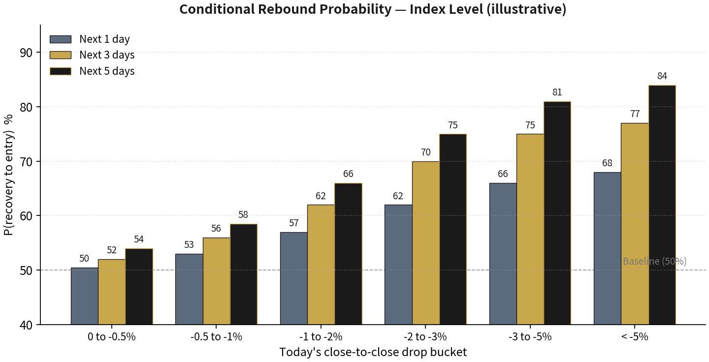
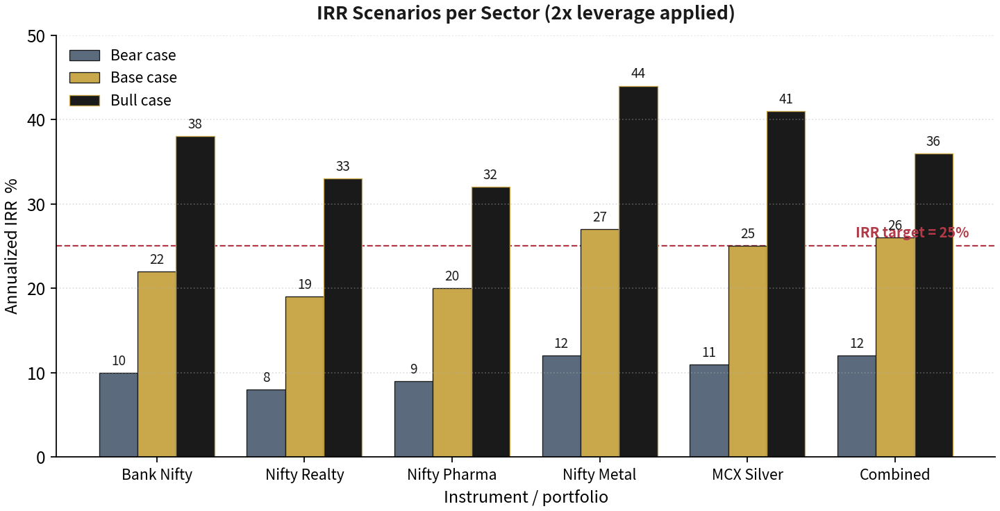

# Dip-Recovery Strategy for Indian Volatile Sectors

A personal research playbook for short-term mean reversion after sharp dips in Bank Nifty, Nifty Realty, Nifty Pharma, Nifty Metal and MCX Silver. Its **25% annualized IRR is an unvalidated target**, not an observed result or forecast.


> ⚠️ **NOT FINANCIAL ADVICE.** This repository documents one individual's personal research playbook. The numbers are illustrative, derived from aggregate index-level studies and synthetic/limited backtests. Trading with leverage can cause losses exceeding your capital. See [`DISCLAIMER.md`](DISCLAIMER.md) before using anything here.

---

## The idea in 30 seconds

1. **RSI alone cannot predict index direction.** It is a momentum *thermometer*, not a forecast. Used standalone, it produces hit rates barely above 50%.
2. **Dip recovery is a hypothesis to test.** The playbook proposes that sharp index drops may be followed by short-term rebounds. Its probability chart is illustrative, not measured evidence for these instruments.
3. **Longer holding windows change both outcomes and risk.** The playbook's rebound probabilities are illustrative; they must be checked against actual prices, costs, and adverse moves.
4. **25% IRR is a research target.** The leverage and regime rules have not been validated as a way to achieve it. The backtest is a skeleton and can use synthetic data when downloads fail.

## Strategy at a glance

| Dimension | Rule |
|---|---|
| Universe | Bank Nifty, Nifty Realty, Nifty Pharma, Nifty Metal, MCX Silver |
| Signal | Daily close drop ≤ sector threshold, RSI(14) in sector band, regime filter ON |
| Entry | Next-day open, limit order 0.2–0.3% below previous close |
| Take profit | 50% off at +0.9% to +1.5% (sector-dependent), 50% trails 0.5–0.8% |
| Time stop | Exit by day 5 at open, no exceptions |
| Hard stop | −2.5% to −3.5% from entry, or regime filter flips OFF |
| Sizing | Fixed-fractional 4–6% of capital per signal, ≥ 20% cash buffer |
| Leverage | 2× default (1.5× Realty), throttled down after −10% drawdown |
| Kill switch | Single-day portfolio loss > 5% → pause 5 sessions + regime re-assessment |

## The edge, visualized

### Conditional rebound probability (the "step function")



The chart depicts the playbook's hypothesis. The shape and probabilities need validation on real instrument data.

### Illustrative IRR scenarios at 2× leverage



| Sector | Bear IRR | Base IRR | Bull IRR | Max DD |
|---|---:|---:|---:|---:|
| Bank Nifty | 10% | 22% | 38% | −12% |
| Nifty Realty | 8% | 19% | 33% | −18% |
| Nifty Pharma | 9% | 20% | 32% | −10% |
| Nifty Metal | 12% | 27% | 44% | −15% |
| MCX Silver | 11% | 25% | 41% | −14% |
| **Combined** | **12%** | **26%** | **36%** | **−13%** |

These scenario values are assumptions, not backtested returns. They do not establish that the combined portfolio can clear the 25% target.

## Sector parameter matrix

| Instrument | Dip threshold | RSI band | TP1 | Trail | Time stop | Hard stop | Leverage |
|---|---:|:---:|---:|---:|:---:|---:|:---:|
| Bank Nifty | −1.5% | 25–45 | +1.0% | 0.5% | Day 5 | −2.5% | 2× |
| Nifty Realty | −2.0% | 20–40 | +1.5% | 0.7% | Day 5 | −3.0% | 1.5× |
| Nifty Pharma | −1.5% | 25–42 | +0.9% | 0.5% | Day 5 | −2.5% | 2× |
| Nifty Metal | −2.0% | 20–42 | +1.4% | 0.7% | Day 5 | −3.0% | 2× |
| MCX Silver | −2.5% | 18–42 | +1.5% | 0.8% | Day 5 | −3.5% | 2× |

## Repository layout

```
dip-recovery-strategy/
├── README.md                  ← you are here
├── DISCLAIMER.md              ← read before deploying capital
├── LICENSE
├── requirements.txt
├── docs/
│   ├── Dip_Recovery_Strategy_Indian_Sectors.pdf     ← full 32-page playbook (read this first)
│   └── Dip_Recovery_Strategy_Indian_Sectors.docx    ← editable Word version
├── backtest/
│   └── dip_recovery_backtest.py                     ← companion backtest skeleton
└── assets/
    ├── fig_rebound_probability.png
    └── fig_irr_scenarios.png
```

The PDF is the authoritative reference: 19 chapters covering the discussion that produced the strategy, the objective and constraints, the mechanism, per-sector playbooks, the 5-layer entry filter stack, exit management, sizing and leverage, IRR scenarios, risk caps, the regime filter, monitoring routines, the backtest framework, a 90-day rollout plan, and the failure-mode catalog.

## Quickstart

### Silver FoF research and paper screening

`silver_fof.py` is a separate, Silver-only workflow for Axis Silver ETF and
Axis Silver Fund of Fund. It requires real daily `Date,Nav` CSV files supplied
by you. Extra CSV columns are ignored. The raw NAV files stay local; the script
does not download data or generate fallback prices.

```bash
python silver_fof.py backtest --etf-csv path/to/Axis_SilverETF.csv --fof-csv path/to/Axis_SilverFoF.csv --split 2026-01-01 --output silver_results.json
python -m unittest discover -s tests
```

The historical signal uses ETF **closing NAV** on date `t`, with the first
possible FoF fill at the **next common closing NAV**. It compares a 2.5% ETF
dip alone, dip plus Wilder RSI(14) in 18–42, and dip plus RSI plus ETF above
its 200-day NAV average. Each is measured over 1, 3, 5 and 10 holding
sessions, separately before and after the split date. Trades do not overlap
within each rule and holding window. The report includes sample sizes, net
win rates, worst trades, and holdout trade details. It models the Axis FoF
0.25% exit load for redemption within seven calendar days and a **user
adjustable assumed** 0.2% roundtrip friction. The friction estimate is not a
fund charge. Returns use published FoF NAV, which already reflects fund
expenses. This is a trade level study, not a portfolio IRR calculation.

For a pre-cutoff paper decision, copy `silver_snapshot.example.json`, replace
every value with an actual timestamped observation, and explicitly set the
three manual checks. Then run:

```bash
python silver_fof.py paper --etf-csv path/to/Axis_SilverETF.csv --fof-csv path/to/Axis_SilverFoF.csv --snapshot my_snapshot.json --output silver_paper_result.json
```

The paper screen rejects quotes older than five minutes, observations at or
after 14:30 IST, and stale daily NAV history. The 14:30 limit is a conservative
workflow buffer, **not** the scheme's official cutoff. See the [Axis scheme
information document](https://www.axismf.com/1/5/85/90/340/453/SIDAxisSilverFundofFund.pdf)
for the applicable order and funds realization rules and the [Axis FoF page](https://www.axismf.com/mutual-funds/fof-domestic/axis-silver-fund-of-fund/sv-dg/direct)
for the current exit load. `event_clear`, `regime_clear`,
and `funds_ready` are manual declarations; this tool does not verify them. A
paper candidate is **not** a trade instruction or a predicted FoF fill. A
same-day FoF application receives the applicable closing NAV, which already
reflects the day's silver move. A daily NAV backtest cannot establish an
intraday pre-cutoff edge; that needs a timestamped paper log with the final
allotted and redeemed NAVs. The paper script neither submits orders nor
calculates position exits.

The legacy sector backtest below is a separate playbook skeleton and may use
synthetic prices when downloads fail. Do not treat its output as evidence for
the Axis Silver FoF workflow.

### Original sector playbook skeleton

```bash
git clone https://github.com/ajaysaxenabtech/dip-recovery-strategy.git
cd dip-recovery-strategy
pip install -r requirements.txt

# Run the backtest (uses yfinance; falls back to synthetic data if offline)
python backtest/dip_recovery_backtest.py
```

Outputs land in `./_reports/`:

| File | Contents |
|---|---|
| `metrics.csv` | Per-sector trades, hit rate, avg win/loss, MAE, approximate IRR |
| `trade_log.csv` | Every simulated trade with entry/exit, reason, MAE/MFE |
| `empirical_rebound.png` | Empirical rebound-probability step function from the run |

Useful flags:

```bash
python backtest/dip_recovery_backtest.py --refresh   # force re-download of price data
python backtest/dip_recovery_backtest.py --summary   # metrics table only, no charts
```

All thresholds live in the `SECTORS` dictionary at the top of the backtest file and mirror the playbook's Chapter 8 parameter matrix — change one, change both.

## The 90-day rollout (from the playbook, Chapter 17)

| Phase | Days | Capital at risk | Advance when | Kill when |
|---|---|---|---|---|
| 1 — Build & backtest | 1–14 | Zero | Backtest reproduces playbook IRR within 3 ppts/sector | Any sector > 5 ppts below playbook |
| 2 — Paper trade | 15–30 | Zero | ≥ 8 signals; paper hit rate within 10 ppts of expected | Regime filter never triggers (bug) |
| 3 — Live, 25% size | 31–60 | 25% of capital, 1× | Live within 10 ppts of paper; no rule violations | Hit rate < 50% or any violation |
| 4 — Scale | 61–90 | 100% of capital, 2× | 30+ trades; DD within Stage-1 throttle | Stage-2 throttle or kill-switch triggers |

## When NOT to trade (regime filter, Chapter 14)

- India VIX > 25 for two consecutive sessions
- Nifty 50 below its 200-DMA by more than 5%
- Within 24 hours of RBI / Fed / CPI / GDP / election results
- Credit-event window (G-Sec yield +30 bps in 5 sessions, or AAA spread widening)
- Global risk-off (DXY +1.5% in 3 sessions with FII outflows > ₹5,000 crore)
- Cool-down active (2 sessions after any stopped-out trade) or cash buffer < 20%

## Roadmap

- [ ] Replace synthetic data with a direct MCX feed for Silver (broker API: Kite / Upstox)
- [ ] Add a time-through-portfolio backtest with concurrent positions and equity-curve tracking
- [ ] Event calendar integration (RBI, Fed, CPI auto-blocked dates)
- [ ] Live signal dashboard (pre-market 9:00–9:15 IST checklist, automated)
- [ ] Rolling 24-month step-function refit with drift alerts

## Contributing

This is a personal playbook, but issues and pull requests are welcome — especially backtest improvements, data-quality fixes, and additional instrument calibrations. Please keep the scope aligned with the playbook's rules-based philosophy: no discretionary overrides, no unhedged event-day positions.

## License

Released under the [MIT License](LICENSE). See [`DISCLAIMER.md`](DISCLAIMER.md) for the full risk disclosure.

---

> **Research status:** validate the signal, executable fills, costs, and drawdowns on real data before considering live use.
